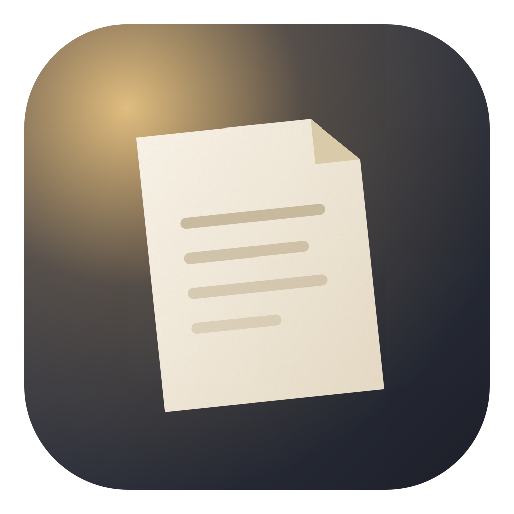
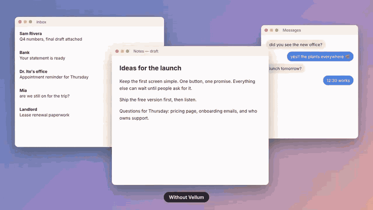
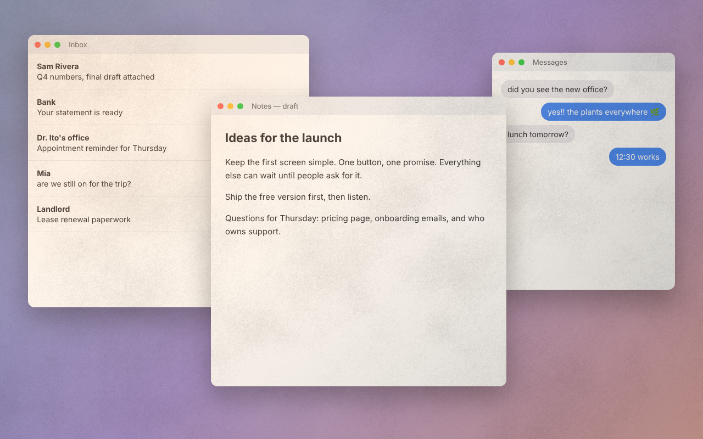
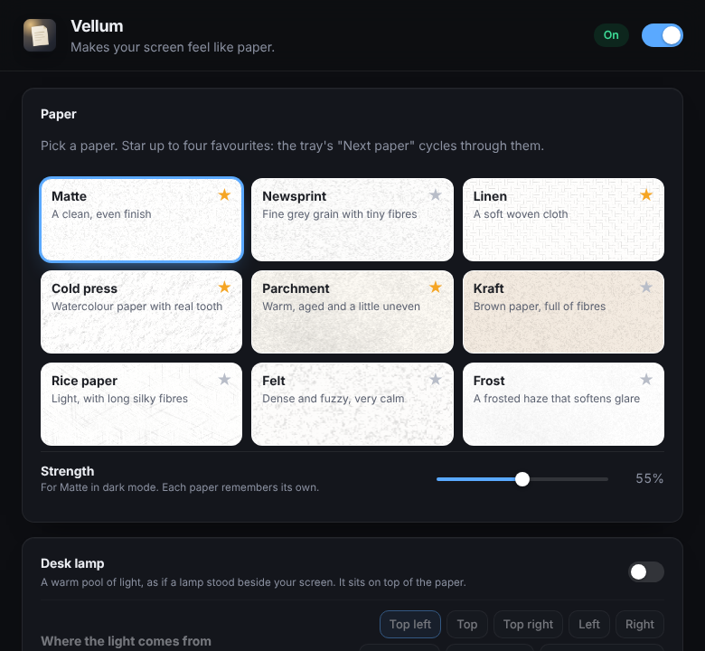

<div align="center">



# Vellum

**Makes your screen feel like paper.**
A subtle paper texture over everything, so your display feels less like a light bulb and more like a page. Add the warm glow of a desk lamp if you like.
Free and open source. No account, no subscription, no ads.

Windows · macOS · Linux



[Demo video (MP4)](docs/demo.mp4) · [Install](#install) · [Papers](#nine-papers) · [Compared to paid apps](#compared-to-paid-paper-screen-apps)

</div>

---

## Install

**Windows** (PowerShell, installs for your user only, no admin needed):

```powershell
irm https://raw.githubusercontent.com/llamaboi55/vellum/main/scripts/install.ps1 | iex
```

**macOS and Linux:**

```sh
curl -fsSL https://raw.githubusercontent.com/llamaboi55/vellum/main/scripts/install.sh | sh
```

Both commands download the latest release straight from GitHub and install it. Files fetched this way don't get flagged, so there's no "unknown publisher" warning to click through. Run the same command again to update. You can also download the installer for your system from [Releases](https://github.com/llamaboi55/vellum/releases/latest).

**Build it yourself** (needs [Rust](https://rustup.rs) and Node.js 18+; on Linux also the [Tauri packages](https://tauri.app/start/prerequisites/)):

```sh
git clone https://github.com/llamaboi55/vellum && cd vellum && npm install && npm run build
```

**Just look at it** (no install): `npm run preview`, then open the printed address. Add `?paper=linen` or `&lamp` to the address to try others.

## Nine papers

| | |
|---|---|
| **Matte** | A clean, even finish. The one to start with. |
| **Newsprint** | Fine grey grain with tiny fibres. |
| **Linen** | A soft woven cloth. |
| **Cold press** | Watercolour paper with real tooth, lit from the top left so it reads as relief. |
| **Parchment** | Warm, aged and a little uneven. Lovely in the evening. |
| **Kraft** | Brown paper, full of fibres. |
| **Rice paper** | Light, with long silky fibres. |
| **Felt** | Dense and fuzzy, very calm. |
| **Frost** | A frosted haze that softens glare. |

Every paper is generated in code by a small shader, so it stays crisp on any screen size or resolution and uses almost no memory. Vellum draws it once and redraws only when something changes.



## What else it does

- **Desk lamp.** A warm pool of light, as if a lamp stood beside your screen. Choose where it stands (or let it follow your mouse), its warmth from candle to daylight, its height, brightness and how much the far corners dim.
- **Strength per paper,** remembered separately for light and dark mode.
- **Day and night.** For example crisp matte by day and warm parchment from 7 pm, switched automatically.
- **App rules.** Turn paper off in photo and video editors, or show it only in your writing apps. Apps you've used recently are suggested as you type.
- **Favourites.** Star up to four papers, then flip between them from the tray.
- **Pause for an hour,** **Alt Shift P** to turn it on and off from anywhere, start with your computer.
- Covers every connected screen, and every click and key goes straight through to your apps.



## Compared to paid paper-screen apps

| | Vellum | Typical paid app |
|---|---|---|
| Price | Free | about $13 |
| Windows and Linux | ✅ | ❌ Mac only |
| Paper textures | 9 | 9 |
| Desk lamp light | ✅ (it can also follow the mouse) | ✅ |
| Day and night papers | ✅ | ✅ |
| Off in chosen apps, or only in chosen apps | ✅ | ✅ |
| Open source | ✅ | ❌ |

## Privacy

Vellum only draws on top of your screen. It never takes screenshots or reads what's on screen. For your app rules it asks the system which app is in front, and that name stays on your computer. It never connects to the internet.

## Good to know

- Vellum changes how the screen *feels*, not its colours. Paper adds a faint tint and grain, so for colour-critical work add your photo or video editor to the app rules.
- Screenshots and screen sharing show the paper too, since it sits on your screen. Press **Alt Shift P** first if you'd rather they didn't.
- **Linux:** the see-through overlay needs a compositor (GNOME, KDE, Cinnamon and most modern desktops have one). App rules work on X11. On Wayland, apps can't see which app is in front, so the paper simply stays on.
- If you plug in or remove a monitor, quit and reopen Vellum so every screen gets paper.

## Development

```sh
npm install
npm run preview      # browser preview with a pretend desktop, no Rust build needed
npm run dev          # the real app with hot reload
npm test             # paper, schedule and app-rule tests (node --test) and Rust tests
```

- `src/js/paper.js`: the nine papers and the lamp, as one WebGL shader
- `src/js/prefs.js`: settings, day and night, app rules (tested)
- `src/js/overlay.js`: the overlay on each screen
- `src/js/settings.js`: the settings window
- `src-tauri/src/lib.rs`: one click-through overlay per monitor, tray, shortcut, pause timer

Releases are built for all three systems by GitHub Actions whenever the version in `src-tauri/tauri.conf.json` changes on `main`.

## Where the idea came from

Found through this Instagram Reel: https://www.instagram.com/p/DZ2oqdivHdF/
This project isn't affiliated with the app shown there.

## License

MIT. Vellum is an independent project and isn't affiliated with any other paper-screen app.
